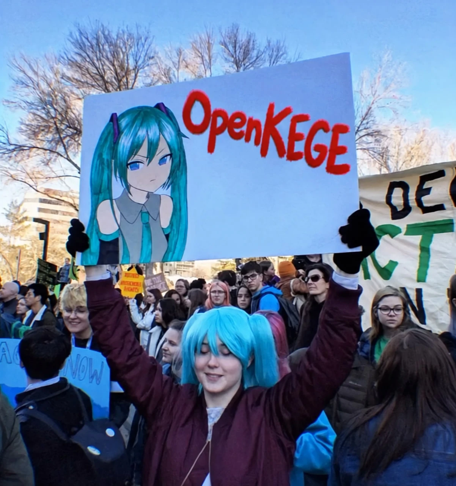

<h1>Nikolai Ivakhnenko</h1>

**Backend developer | C# / .NET | Java**  

## About

- Java Developer at Sber.
- My main stack is C# / ASP.NET Core. My own products are built on it.
- I work in both .NET and the JVM, and I can take on the frontend (React, Vue, Astro) when a project needs it.
- BSc in Applied Mathematics and Computer Science, Southern Federal University (2026).
- Open to backend roles, remote or with relocation.

## Projects

### [Tomorrow, I Promise](https://tomorrow-i-promise.ru/)

Pixel-art visual novel about a hard choice. It runs in the browser and on phones. Made together with [Elizaveta Makarova](https://t.me/displiceat).

**Stack:** Expo · Ink · TypeScript · [Play](https://tomorrow-i-promise.ru/) · [Code](https://github.com/CompleWin/tomorrow-i-promise)

### [OpenKEGE Articles](https://articles.openkege.ru/)

Open articles portal in production: quizzes and a Python editor that runs code in the browser. Outside authors contribute through pull requests.

**Stack:** Astro · React · TypeScript · MDX · Pyodide · KaTeX · [Site](https://articles.openkege.ru/) · [Code](https://github.com/CompleWin/articles.openkege.ru)

### More

| Project | What it is | Stack |
|---|---|---|
| **[GamesDB](https://github.com/CompleWin/gamesdb.complewin.ru)** · [site](https://gamesdb.complewin.ru/) | Game deals search on the CheapShark API: price comparison across stores, price history, deal analytics. | React 19 · TypeScript · TanStack Query · Chart.js |
| **[Sudoku](https://github.com/CompleWin/sudoku-game)** | Browser Sudoku with real-time multiplayer: two players on one board, three difficulty levels, a mistake limit, a timer, Russian and English UI. | Phaser · Node.js · Socket.IO |
| **[anki-cloze-cards](https://github.com/CompleWin/anki-cloze-cards)** | Claude Code agent skill that turns an English word or idiom into an Anki cloze card in context and imports it through AnkiConnect. | Python · AnkiConnect |

## Stack

**Backend**

**Frontend**

**Tools**

